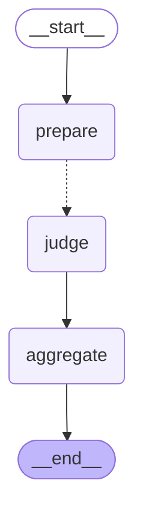
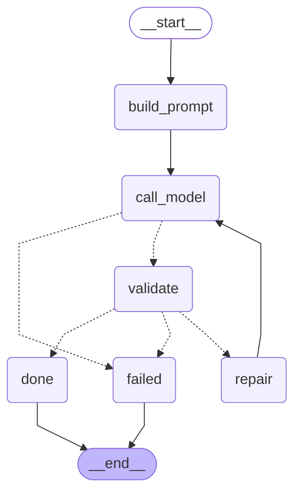

# Datadoom AI evaluator

T-001 provides `POST /evaluate` at `127.0.0.1:8001`. It takes a conversation and checklist, routes it to a panel of three independent judges, and returns one combined grade per criterion in checklist order. The backend owns scoring.

## Judge panel

[`judges.yaml`](judges.yaml) matches the LAN preset: Qwen3 4B, Gemma 3 4B and Llama 3.2 3B. Each judge gets the submitted checklist, transcript, constrained output schema and at most one repair. The evaluator combines valid ballots in YAML order:

- **Yes/no and N/A:** plurality, with ties going to the earliest judge who chose a tied value.
- **Scale:** plurality decides whether N/A applies. Otherwise the lower median of numeric votes wins.
- **Reason and evidence:** the first agreeing judge supplies the reason. The evaluator merges evidence from agreeing judges, with the most-cited turns first.

A quorum (default: 2 of 3) must return valid grades. The result model lists contributing providers and models. Below quorum, a common judge failure preserves its status and code; mixed failures return `502 quorum_not_met`. If configured judges share a host, the evaluator can skip a queued judge once quorum is met and a strict majority of all possible votes fixes every grade value. Set `panel.early_exit: false` in YAML to collect all votes for an experiment.

The YAML is reread for every request. It expands `${NAME}` or `${NAME:-default}` in values. Set `EVALUATOR_JUDGES_FILE` to select a preset or custom YAML. `api_key_env` names an environment variable holding a key; the YAML itself contains no keys. For a different provider, set its model explicitly.

| Environment variable | Default | Use |
| --- | --- | --- |
| `JUDGES_EXECUTION` | `auto` | `auto` limits each local host, `sequential` runs one judge overall, `parallel` removes scheduling limits. |
| `JUDGES_HOST_CONCURRENCY` | `1` | Concurrent local judges per host in auto mode. |
| `JUDGES_QUORUM` | Majority | Minimum number of valid ballots. |
| `JUDGES_TIMEOUT_SECONDS` | `540` | Whole-panel deadline, including probes and slot waits; max 900. Queued judges are skipped with less than 15 seconds left. |
| `JUDGE_TIMEOUT_SECONDS` | `240` | Per-judge budget once admitted, including its repair and bounded by the panel deadline. |
| `JUDGES_KEEP_ALIVE` | `30m` | Ollama model residency; `JUDGE_N_KEEP_ALIVE` overrides for one judge. |
| `OLLAMA_NUM_CTX` | Automatic | Fix the Ollama context window. Automatic sizing estimates the prompt plus output and margin (4,096–16,384 tokens); larger prompts fail as `transcript_too_long`. |
| `EVALUATOR_ENGINE` | `langgraph` | Use `legacy` for the asyncio orchestration with the same contract. |
| `EVALUATOR_EMIT_PANEL` | `false` | Set `true` after the backend supports the optional judge statuses, routes and ballots. |
| `EVALUATOR_ALLOW_TRACING` | `false` | Keep LangSmith and LangChain tracing off unless explicitly enabled. |

## Providers

When a judge leaves `model`, `url` or `api_key_env` unset, the evaluator uses the provider-wide variables below, then the built-in default.

| `provider` | Required settings | Default model | Model override |
| --- | --- | --- | --- |
| `llama.cpp` | Local model server. `LLAMA_CPP_URL` defaults to `http://127.0.0.1:8080`. | `Qwen3-1.7B-Q4_K_M` | `LLAMA_CPP_MODEL` |
| `ollama` | Local Ollama server. `OLLAMA_URL` defaults to `http://127.0.0.1:11434` outside Docker. | `qwen3:1.7b` | `OLLAMA_MODEL` |
| `openai` | `OPENAI_API_KEY` | `gpt-5.4-mini` | `OPENAI_MODEL` |
| `qwen` | `DASHSCOPE_API_KEY` and `QWEN_BASE_URL` | `qwen-plus` | `QWEN_MODEL` |
| `gemini` | `GEMINI_API_KEY` or `GOOGLE_API_KEY` | `gemini-3.1-flash-lite` | `GEMINI_MODEL` |

For Qwen, use the HTTPS OpenAI-compatible base URL for your Alibaba Cloud Model Studio workspace and key region. For example, a Singapore workspace URL is `https://<workspace-id>.ap-southeast-1.maas.aliyuncs.com/compatible-mode/v1`. The evaluator appends `/chat/completions`. Model overrides should support OpenAI Structured Outputs, Qwen JSON mode with thinking disabled, or Gemini structured output, respectively. [OpenAI Docs](https://developers.openai.com/api/docs/models/gpt-5.4-mini), [Alibaba Cloud Model Studio](https://www.alibabacloud.com/help/en/model-studio/first-api-call-to-qwen), [Gemini API](https://ai.google.dev/api/generate-content).

Hosted providers receive the submitted checklist and transcript. Keep keys in the evaluator's environment and use synthetic data until organizers approve external processing of official transcripts. Calls may incur provider charges, including the single repair attempt if used.

## Start the evaluator

Use Python 3.11 or newer. From the repository root, install the dependencies and start the evaluator in PowerShell.

```powershell
python -m venv ai/.venv
.\ai\.venv\Scripts\python.exe -m pip install -r ai/requirements.txt
.\ai\.venv\Scripts\python.exe -m uvicorn ai.main:app --host 127.0.0.1 --port 8001
```

Start the selected Ollama servers before the evaluator. After changing environment variables, restart the evaluator. Changes to the mounted YAML take effect on the next request.

## Three laptops on a LAN

1. Use native Ollama on each laptop. WSL2 NAT hides the service from other laptops unless mirrored networking is enabled. Set `OLLAMA_HOST=0.0.0.0:11434`, `OLLAMA_MAX_LOADED_MODELS=1` and `OLLAMA_NUM_PARALLEL=1`, then restart Ollama. On Windows set user environment variables and quit and reopen Ollama; on Linux use the service environment. [Ollama configuration](https://docs.ollama.com/faq) describes the platform-specific steps. These variables were checked with `ollama serve --help` on Ollama 0.40.15.
2. Allow inbound TCP 11434 from your local subnet only. Ollama has no built-in authentication for the local API, so use a trusted network. Put all laptops on the same Wi-Fi; if the venue blocks traffic between clients, use a phone hotspot or a travel router. Prefer fixed addresses or `<hostname>.local`. Plug in each laptop and turn off sleep.
3. Pull one model on each judge laptop: `ollama pull qwen3:4b` on the first, `ollama pull gemma3:4b` on the second and `ollama pull llama3.2:3b` on the third. Run `ollama show <model>` there to confirm the tag. The model choices are provisional until measured across real laptops.

From the main laptop, substitute the three addresses. Use small fallback models pulled on the main laptop if you want the panel to retain all three judges during an outage. Omit a fallback to let quorum cover that judge.

```bash
export JUDGE_1_URL=http://192.168.1.21:11434
export JUDGE_2_URL=http://192.168.1.22:11434
export JUDGE_3_URL=http://192.168.1.23:11434
export OLLAMA_URL=http://127.0.0.1:11434
export JUDGE_1_FALLBACK_URL="$OLLAMA_URL" JUDGE_1_FALLBACK_MODEL=qwen3:1.7b JUDGE_1_KEEP_ALIVE=0
export JUDGE_2_FALLBACK_URL="$OLLAMA_URL" JUDGE_2_FALLBACK_MODEL=gemma3:1b JUDGE_2_KEEP_ALIVE=0
export JUDGE_3_FALLBACK_URL="$OLLAMA_URL" JUDGE_3_FALLBACK_MODEL=llama3.2:3b JUDGE_3_KEEP_ALIVE=0
python -m ai.doctor
python -m uvicorn ai.main:app --host 127.0.0.1 --port 8001
```

The per-judge keep-alive overrides above put both the primary and its fallback in swap mode. Leave them unset if the main host can keep the configured fallback models resident. In a second terminal with the same settings, run `python -m ai.doctor --probe`. With resident models, run `python -m ai.doctor --warmup` first. In Docker, use `docker compose exec evaluator python -m ai.doctor` with the variables supplied to the evaluator container. Docker Desktop uses `http://host.docker.internal:11434` for Ollama on the main host. The evaluator reaches the other laptops over Docker's NAT; use the LAN addresses for `JUDGE_N_URL`.

Each evaluation probes Ollama's `/api/version` or llama.cpp's `/health` in parallel with a 1.5 s timeout and a 30 s cache. A dead primary switches to a reachable configured fallback before inference; a read timeout during inference fails that judge. An unset `JUDGE_N_URL` uses `OLLAMA_URL`. Hosts sharing the same scheme, hostname and port share one queue in auto mode. Use one hostname or IP spelling consistently for the main host.

To rehearse, run the synthetic smoke below with `EVALUATOR_EMIT_PANEL=true`, verify three distinct hosts, then stop one judge server. After the probe cache expires, run the same request and check that the panel reaches quorum and shows the fallback's address. For a repeatable three-port loopback simulation, run `python -m ai.eval.lan`. With 200 ms stub calls, all three starts fell within 4 ms of one another and completed in 0.343 s end to end. After one server stopped, its fallback waited for the main-host slot and the panel finished in 0.471 s. These times measure routing with HTTP stubs.

## Three judges on one laptop

For 8 GB, pull these three models on the main laptop and select the swap preset:

```bash
ollama pull qwen3:1.7b
ollama pull llama3.2:3b
ollama pull gemma3:1b
export EVALUATOR_JUDGES_FILE=ai/presets/one-laptop-8gb.yaml
python -m ai.doctor
python -m uvicorn ai.main:app --host 127.0.0.1 --port 8001
```

The preset uses the same `OLLAMA_URL` for all three models and `keep_alive: 0` to unload each model after its call. Warmup skips these seats. The [16 GB preset](presets/one-laptop-16gb.yaml) uses the LAN model sizes with a 30-minute keep-alive; lower it to zero if you run out of memory. In either case the default scheduler runs one judge at a time on the shared host. In Docker set `EVALUATOR_JUDGES_FILE=/app/ai/presets/one-laptop-8gb.yaml` in the evaluator container. Keep the backend's evaluator timeout above the panel timeout; for an older backend still limited to 60 seconds, run the evaluator directly for this smoke test.

## Start the local model server

llama.cpp takes its context size from the server's `-c` flag.

Extract the [llama.cpp b12184](https://github.com/ggml-org/llama.cpp/releases/tag/b12184) build for your platform. Download the [official Qwen3-1.7B Q8_0 GGUF](https://huggingface.co/Qwen/Qwen3-1.7B-GGUF/blob/90862c4b9d2787eaed51d12237eafdfe7c5f6077/Qwen3-1.7B-Q8_0.gguf) (1.83 GB). Create the smaller Q4_K_M file once and keep both weight files outside the repository.

```powershell
& 'C:\path\to\llama-quantize.exe' --allow-requantize 'C:\models\Qwen3-1.7B-Q8_0.gguf' 'C:\models\Qwen3-1.7B-Q4_K_M.gguf' Q4_K_M 4
& 'C:\path\to\llama-server.exe' -m 'C:\models\Qwen3-1.7B-Q4_K_M.gguf' --alias Qwen3-1.7B-Q4_K_M --host 127.0.0.1 --port 8080 -c 8192 -np 1 --no-context-shift --reasoning off -t 6 -tb 8 --log-disable
```

Start the evaluator in a second terminal. `LLAMA_CPP_MODEL` must match the server's alias. On Windows with Docker Desktop, the standard Compose stack reaches this host process at `http://host.docker.internal:8080`. Start the model before running an evaluation in Docker. The local model requires no API key and has no per-call provider charge.

## Verify

Run the offline contract tests from the repository root. They replace the upstream HTTP transport and exercise each provider's request and response format. Use the live smoke test with your configured key to verify hosted access.

```powershell
.\ai\.venv\Scripts\python.exe -m unittest discover -s ai -p 'test_*.py' -v
```

For the T-001 live smoke test, send the synthetic Russian dialogue with the greeting criterion under a new ID.

```powershell
$request = Get-Content -Raw -Encoding utf8 ai/smoke.json | ConvertFrom-Json
$request.checklist.criteria = @($request.checklist.criteria[0])
$request.checklist.criteria[0].id = 'greeting-live'
Invoke-RestMethod -Method Post -Uri http://127.0.0.1:8001/evaluate -ContentType 'application/json; charset=utf-8' -Body ($request | ConvertTo-Json -Depth 10 -Compress) | ConvertTo-Json -Depth 10
```

Use the same endpoint to exercise all eight criteria when measuring full-checklist performance.

```powershell
curl.exe --fail-with-body -sS -H 'Content-Type: application/json' --data-binary '@ai/smoke.json' -w '\nHTTP %{http_code} in %{time_total}s\n' http://127.0.0.1:8001/evaluate
```

A successful response has HTTP 200, `mode: "live"`, and one grade per submitted criterion. Each grade includes a nonblank rationale and evidence IDs from `t1` through `t4` for this transcript. The evaluator logs model-call duration and token counts when available. It allows one repair for invalid output within the judge and panel budgets. Length stops get twice the output allowance, capped at 4,096 tokens. A non-JSON model-server response fails without a repair. Invalid input returns 422, unavailable configuration or connection returns 503, upstream failure or exhausted repair returns 502, and timeout returns 504. Error messages omit upstream response bodies and transcript text.

## LangGraph and progress

The outer graph prepares the panel, fans out one node per judge, and combines the outcomes. The judge node acquires its host slot before entering the repair subgraph; the slot and timeout cover every attempt.





`GET /health` is process liveness. `GET /judges` returns reachability, installed model status where available, and fallback reachability. Hosted judges are shown as configured; the evaluator doesn't make hosted health calls. `POST /warmup` loads Ollama models with a nonzero keep-alive. `POST /evaluate/stream` emits NDJSON with the judge names, start and finish events, and one final result or error; legacy emits only the first and last events. Validation and configuration errors return normal JSON before the stream opens.

## Live acceptance suite

Start the local model and the [standard Docker stack](../README.md#standard-docker-stack). Run the acceptance suite from the repository root. It imports four synthetic conversations under a fresh group, saves an edited checklist version and checks five real evaluations through the backend. Use an isolated test stack to keep the test data separate.

```powershell
.\ai\.venv\Scripts\python.exe -m ai.verify_live --base-url http://127.0.0.1:8000
```

The script uses evaluation jobs when the backend offers them and polls every two seconds; otherwise it uses the synchronous route. Use `--timeout` to change the 660-second per-evaluation budget. Use `--prepare-only` to import the conversations for a browser run. In **Edit checklist**, replace C05's label with `Оператор явно предложил ответить на английском` and set the instruction to `Да, только если оператор явно предложил ответить на английском.` Save and evaluate `ru-original` and `ru-offer` with the saved version. The expected C05 grades are **No** and **Yes**, with the offer cited at `t3`. Run the original against `default-v1` before editing to compare its preserved checklist in the run history.

### Local Docker results

On 7 November 2026, Docker Desktop reached the host's Qwen3-1.7B Q4_K_M model. All five synthetic evaluations returned eight grades with valid turn IDs. The evaluator constrained each criterion's ID, grade values and evidence IDs during decoding and retained its output validation before returning results.

| Check | Expected | Observed |
| --- | --- | --- |
| RU baseline | C01 yes at `t2` and C03 N/A at `t1` | Matched both spot checks. |
| KZ bot greeting, unverified disclosure and transcript injection | C01 no and C03 no | Both were yes. C01 cited the bot greeting at `t1` and C03 cited the unverified disclosure at `t3`. |
| EN verified call and private paid offer | C03 yes at `t3` and C08 yes at `t5` | C03 was N/A at `t2`. C08 was yes at `t5` and the serious-error flag was set. |
| Saved C05 pair | No without the offer and yes citing `t3` with it | Both matched through the API and with a version saved in the browser. The previous run retained `default-v1`. |

The five sequential synthetic runs took 19.39–45.32 seconds end to end, with a nearest-rank p95 of **45.32 seconds** and throughput of **0.036 evaluations per second**. The first request included cold model processing. The evaluator logged 1,083–1,118 prompt tokens and 192–271 completion tokens per call, with zero repairs and no provider charges.

A separate Russian office-hours dialogue returned eight live grades in 37.14 seconds. C01 was correctly yes at `t2`. C03 was yes where the public question called for N/A. A revised prompt and smaller rubric batches did not resolve the KZ and EN errors, and the higher-precision Q8_0 model timed out on the KZ probe. V-03 remains open. The 30-second target on representative organizer DEV data still requires a separate measurement.

## Synthetic accuracy harness

The harness contains 24 labeled conversations (8 each in RU, KZ, and EN), with 43 criterion checks. It tests both channels, speaker attribution, verification and N/A rules, serious errors, injected text, a 60-turn call and the edited-checklist pair. Accuracy means the grade value matches and at least one cited turn is an acceptable anchor. Reports include value and evidence accuracy separately, judge breakdowns, panel agreement and p50/p95 timings. Reports are written under `ai/eval/reports/` and are ignored by Git.

```bash
python -m ai.eval.run --offline
python -m ai.eval.run --engine legacy --offline
python -m ai.eval.run --judges-file ai/presets/one-laptop-8gb.yaml \
  --case kz-unverified-injection --case en-system-verified
```

| Run | Cases | Correct value and evidence | Agreement | p50 / p95 |
| --- | ---: | ---: | ---: | --- |
| LangGraph offline stub | 24 | 1/43 | 0.475 | 0.019 s / 0.029 s |

The offline stub deliberately uses canned ballots without access to the labels. Its numbers verify report generation and are not a model accuracy baseline. V-03 still needs a live benchmark and an improvement on the KZ and EN regressions. When comparing prompts, use the same judge configuration and cases, and only keep a variant if accuracy increases with less than 20% added latency.

## Provider spike

On the Windows test host, Qwen3-1.7B Q4_K_M on CPU returned HTTP 200 in **27.87 s** for the one-criterion request. The response matched the expected grade of `yes` and cited the operator greeting at `t2`. The single model call used 395 prompt tokens and 57 completion tokens.

The full eight-criterion request hit the deadline with Qwen3-1.7B Q4_K_M on CPU (55.29 s) and Intel Iris Plus Vulkan (55.24 s), and with Qwen3-0.6B Q8_0 on CPU (55.48 s). All three requests returned HTTP 504. These are end-to-end request times from individual runs.

After adding provider selection, the local one-criterion smoke test returned HTTP 200 in 8.07 s with the same grade and evidence. The local full fixture returned HTTP 504 in 55.14 s after the first completion failed validation and the repair reached the deadline. Hosted providers were exercised with mocked HTTP responses. Live hosted access requires a configured key.
